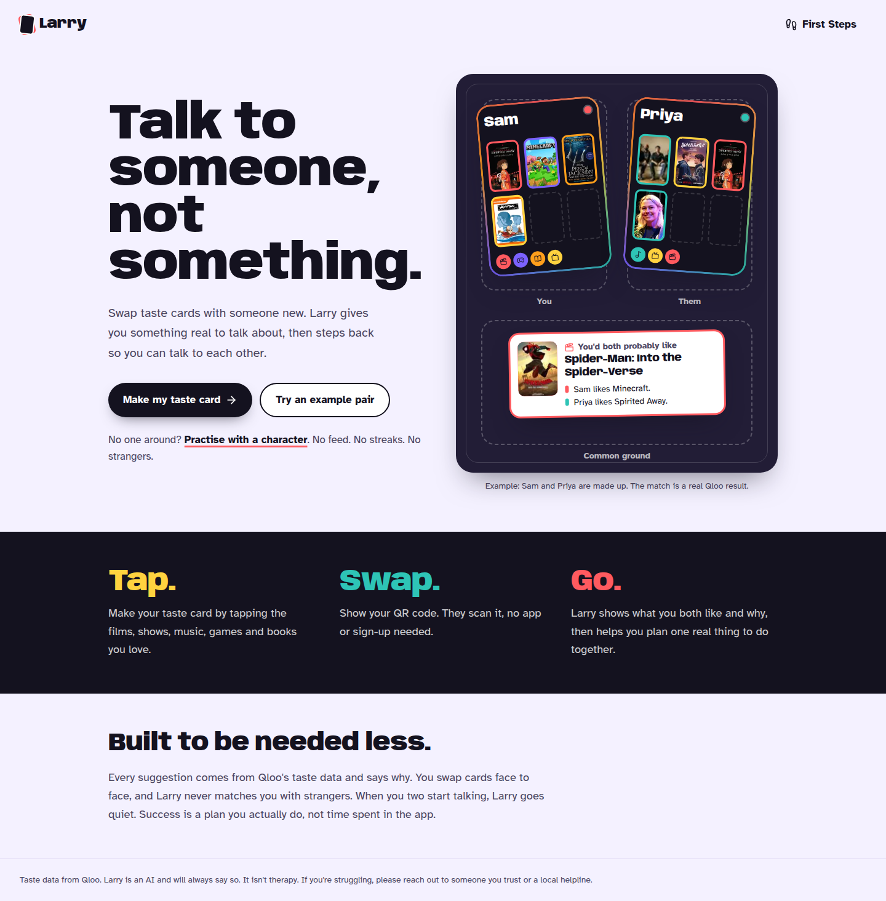

# Larry: talk to someone, not something

Larry helps lonely and socially anxious people meet real friends in the real world. You make a **taste card** (films, TV, music, games, books, sport, podcasts, brands, travel and people you love). You start a **group** with friends by showing a QR code. Larry uses [Qloo](https://qloo.com)'s taste graph to find your **common ground**, then turns it into a **Plan Ticket** for a real, open place nearby. You go, you **check in**, and you earn **Glory**. Larry is the AI in the middle that gets you to a person, then steps back.

Built for the **Qloo Agentic Hackathon** ("Agents, but with taste.").



## Why

- Young adults are the loneliest age group. In the Meta-Gallup survey of 142 countries, 27% of 19–29-year-olds reported feeling lonely.
- Lonely people already confide in chatbots. But heavy chatbot use is linked with *more* loneliness and dependence (OpenAI × MIT Media Lab, 2025).
- Showing people what they have in common measurably increases friendship formation (Sun & Taylor, 2020, a randomized field study).

Larry uses AI to get you to a person, then gets out of the way.

## How it works

1. **Taste card.** Tap posters and covers: the picker opens on a grid of real Qloo art, with search as a backup. You need no account, and your card stays on your phone. You can also teach Larry your taste in a short solo chat ("Talk taste with Larry"); what it learns is shown and you can edit it.
2. **Group by QR.** Tap "Start a group", pick the size (2 to 5 people, you included), and show the QR. Whoever scans it joins until the group is full. Scanning in person is the consent, so there are no invitations, no user search and no messages from strangers. The QR stops working after a short time or when the group is full.
3. **Larry's common ground.** Larry opens every new group with what you all share and one easy opener. Each item comes from Qloo with a "Why this?" that names whose picks led there. After that Larry stays quiet until someone tags it: type **@Larry**, or tap the @Larry button for the menu (Plan, Common ground, Gems, Twin, Rising, Match Day, Mood, Excuse, Hello, Help).
4. **Plan Ticket.** Ask for a plan and Larry picks one real place that fits everyone: open at the time it suggests, a short walk away, tagged Calm, Cosy or Lively, with how it fits each person, a thing from your common ground to bring up, and a plan B.
5. **Check-in.** At the place, tap to check in when you arrive and again when you leave. The server checks that you were really there, then keeps only the count.
6. **Glory.** Real visits earn Glory (one lifetime score that never goes down) and titles: private stages at each place (Rookie to Legend), titles among friends, and an optional public podium per place. Nothing is earned from chat, app opens or spending.

Other ways in:
- **Practice partners.** Made-up characters with real Qloo tastes, labelled as made-up, so you can rehearse talking about what you love. A round is short, and it ends with a step to try with a real person.
- **Mood and the Quiet-to-Lively Ladder.** One optional tap for how you feel today. Larry uses it, and how far you have climbed, to choose a calmer or livelier next place.
- **Larry's next move.** For a signed-in person, one Larry-written next step at most once a day, which you can close or reopen.

## How Qloo is used (it does not work without it)

| What | Qloo call |
|---|---|
| Picture picker | `GET /search` across the taste categories, with Qloo poster and cover art |
| Common ground ("bridges") | `GET /v2/insights` with **everyone's picks** as `signal.interests.entities`, per domain, with `feature.explainability=true`. Explainability splits the credit between people, so a result is a bridge only when it really comes from more than one person's taste. Larry then keeps the bridges that truly fit everyone, drops poor fits, and says why in specific words |
| Recommendations in chat | `GET /v2/insights` for one person or the whole group, in any domain |
| New interests mentioned in chat | `GET /search`, then added to that person's taste |
| Places for a Plan Ticket | `GET /v2/insights?filter.type=urn:entity:place` with `filter.location`, per low-pressure hangout type. Each place gets a reason from explainability and a Calm, Cosy or Lively tag. Amazon Location adds opening hours when Qloo has none, walking time, and the order of stops; Qloo still picks every place |
| Hidden Gems, Taste Fingerprint, Match Day | Qloo's popularity, cross-domain affinity and audience signals, each shown as a reason inside a plan, never as a feed |

An LLM alone can only guess at taste. Qloo's affinities come from what real people like, and explainability lets Larry say *why*. When Qloo has nothing to say, Larry says so instead of making something up.

## The agent

`src/lib/agent.ts` runs Claude (`claude-opus-5-5`) with the Anthropic SDK tool runner and tools such as `find_common_ground`, `recommend`, `add_interest`, `find_places_nearby`, `make_plan_ticket`, `save_first_step` and `remember`.

- **Grounded opening.** Common ground is fetched first and handed to the agent, so Larry's first line is built on real Qloo results. Larry always says it is an AI.
- **Visible work.** Replies stream, with a short progress line before each tool runs ("Checking Qloo for games you'd both like…").
- **Rules.** Replies are one or two easy-read sentences, every recommendation is backed by a tool result with a reason, and every conversation ends at a door: one real next step. Larry never pretends to be human or guesses pronouns.
- **Fallbacks.** If the model is unavailable, plain fixed lines and Qloo's own ranking take over, so the app still ends in a plan.

## Privacy and safety

- **Consent first.** People connect only in person, by scanning a QR. There is no user search, no follow and no messages from strangers. Every chat has one-tap Leave, Unfriend, Block and Report. Unfriend is silent and immediate.
- **Counts, not a diary.** Check-ins keep folded counts only (place, visits, stage). Location is checked on the server at the moment you tap and then thrown away. No arrive or leave times and no week-by-week history leave the phone.
- **No stalking.** Nobody can see anyone's location, venue history, schedule or "last seen". Strangers see a username and title counts only, never venue names or times. Each place's podium uses a different anonymous name per person, so a podium can't be linked to a profile, and the database can't join the two.
- **Accounts only when needed.** Making a card, chatting with Larry, practice and places work without an account. Accounts are for adults and are verified by phone. The username is a made-up name from a generator (like QuietOtter42), and name, phone number and date of birth are never shown to anyone.
- **Under 18s.** Larry works on their own device without an account, with no friends, groups, podiums or Open to meet.
- **Open to meet** (adults only) works only when two people are checked in at the same public place, have both switched it on, share something real, and both wave. Before that, others see only an anonymous count.
- **Larry watches out.** A crisis check answers self-harm or crisis language with a calm message and helplines, without calling the model. In chats, Larry steps in warmly when someone asks for addresses, money, contact details or a private meeting place.
- **Untrusted input.** Names and titles from QR links and chats are cleaned and passed to the model only as data, never as instructions. Links, emails, phone numbers and markdown are stripped from replies.
- **Fair use.** Every API route has rate limits and the chat has a spend cap, so the demo stays available for everyone.
- **Deletion.** One place in the app deletes your account and everything linked to it.

## Design principles

- **Real world first:** success is counted in First Steps and verified visits, not time in the app.
- **Grounded, not guessed:** taste claims come from Qloo with a reason.
- **Never addictive to the screen:** no feeds, no infinite chat, no daily or chat streaks; weekly real-world counts pause instead of breaking. Larry goes quiet when people talk to each other.
- **Earned outside:** Glory, titles and counts come only from verified real-world visits, never from chat, app opens or spending, and never go down.
- **Nobody is left out:** picture-first and easy-read. Every action works by tapping alone. Atkinson Hyperlegible type, targets of 48px or larger, and reduced motion are respected.

## Run it locally

```bash
npm install
cp .env.example .env.local   # then fill in the keys
npm run dev                  # http://localhost:3000
npm test                     # unit tests
npm run test:e2e             # Playwright end-to-end tests
```

| Variable | What |
|---|---|
| `QLOO_KEY` | Qloo hackathon API key |
| `QLOO_SERVER_URL` | `https://hackathon.api.qloo.com` |
| `ANTHROPIC_API_KEY` | Anthropic API key for the agent (Claude). Bring your own key. The model calls sit in a few files (`src/lib/agent.ts`, `src/lib/suggest.ts`, `src/lib/witty.ts`), so another LLM provider can be swapped in there. |
| `ANTHROPIC_BUDGET_USD` | In-app spend cap for the chat |
| `NEXT_PUBLIC_FIREBASE_*`, `GOOGLE_CLOUD_PROJECT` | Optional: phone sign-in and Firestore. Without them, accounts are hidden and data stays in memory |

Every variable is described in [`.env.example`](.env.example). Real values live only in `.env` and on the server, never in the repo.

## Deploy

Larry runs as one Next.js server on a small Linux server, behind a reverse proxy that serves HTTPS and adds the security headers. The scripts in [`deploy/`](deploy/) set up the server, write its environment file from your local `.env`, build the app with the public Firebase config, and run it as a system service. Production uses Firestore, which client devices can't read or write directly: all data goes through the server. Fill in your own project, region and host when you run them.

## Testing account

Judges get one testing account through the hackathon's private testing notes. Its sign-in details are never written in this repo. It follows the same privacy and consent rules as every other account.

## Stack

Next.js 16 (App Router), TypeScript, Tailwind CSS v4 with design tokens (see [DESIGN.md](DESIGN.md) and the word list in [docs/glossary.md](docs/glossary.md)), Anthropic TypeScript SDK, Qloo Insights API, Firebase Auth and Firestore, Amazon Location, Zod, motion, Radix, Lucide and qrcode.

## Notes

- Practice partners and example people are made up and labelled as such. Their picks are real Qloo entities.
- Speech-to-text uses the browser's built-in recognition (Chrome, Edge, Safari), for chat messages and name fields.
- Accessibility: WCAG 2.2 AA as the target. Easy-read copy, Atkinson Hyperlegible, targets of 48px or more, focus kept when sending and in panels, live regions for loading and replies, and reduced motion respected.
- Built with AI assistance (Claude Code).

## License

[GNU AGPL-3.0](LICENSE): you can use, study and change Larry, but if you run a modified version as a website or service, you must share its source under the same licence.
